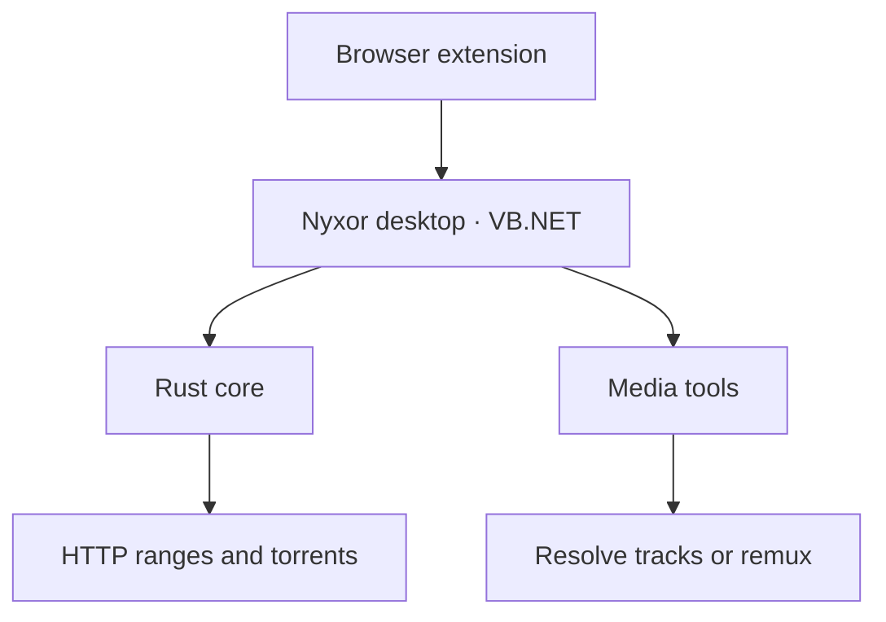
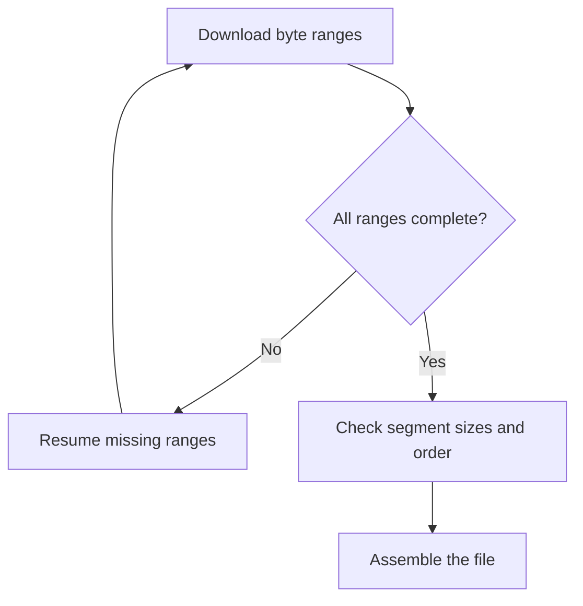

<h1 align="center">⚡ Nyxor Download Manager</h1>

<p align="center">Resumable downloads, BitTorrent, and live recording for Windows.</p>

<p align="center">
  <a href="https://github.com/UacoderSYS/Nyxor-Download-Manager/releases/latest"></a>
  <a href="#get-started"></a>
  <a href="#architecture"></a>
</p>

<p align="center">
  <a href="#architecture">Architecture</a> · <a href="#media">Media &amp; DVR</a> · <a href="#torrents">Torrents</a> · <a href="#browser-extension">Browser extension</a> · <a href="#get-started">Quick start</a> · <a href="#contact">Support</a>
</p>

If a connection drops halfway through a large file, Nyxor remembers which parts reached disk. Reopen the app to resume the transfer, set a speed limit while you work, or watch individual connections finish in the live monitor. Videos, torrents, and direct links share the same download queue.

[](https://github.com/user-attachments/assets/63913aa4-91e1-47db-8723-95221073a098)

<a name="architecture"></a>

## 🧩 Inside the download engine

The **VB.NET desktop app** runs on .NET Framework 4.8. Its custom GDI+ interface displays the queue, settings, and live progress. A native Rust library, **`nyxor_core.dll`**, handles segmented HTTP and HTTPS transfers and BitTorrent networking.

The browser extension sends a link to the desktop app over a local connection. From the same queue, Nyxor can start a transfer through its Rust core or use the media tools to find tracks and process a recording.



### How a download resumes

For a direct download on a server that supports byte ranges, Nyxor tracks which parts have reached disk. The live monitor shows each segment and lets you change the speed limit while the transfer runs.



- **Connection scaling.** Nyxor measures throughput as it downloads and can use up to 128 parallel streams. If one connection is still working through a long range near the end, an idle worker can take over part of it.
- **Resume checks.** After an interruption, the engine checks the range and length returned by the server against the saved position. A connection that closes early leaves a range pending.
- **Final assembly.** With enough free space, Nyxor keeps the original segments until it has written and verified the output. When disk space is tight, it merges the segments progressively.

[](https://github.com/user-attachments/assets/a6d8e414-7df7-4237-954b-31d1f18492b4)

<a name="media"></a>

## 🎬 Media Grabber and live DVR

Paste a video or playlist link into **Media Grabber** to see the picture and audio tracks the source actually offers. For a dubbed video, you can select the original soundtrack or an available language such as Arabic. Video quality goes up to 8K at 60 fps on sources that provide it.

[](https://github.com/user-attachments/assets/2c5b519c-b80d-453a-a196-ed5218e8086e)

**Live recording.** Record HLS, DASH, or FLV broadcasts and set a stop timer. The recorder can filter ad breaks on supported sources. Supported media sites include YouTube, TikTok, Twitch, Facebook, Instagram, Reddit, and X.

**Expiring links.** Some services give a media URL a short lifetime. When it expires mid-transfer, **Auto-Healing** tries to obtain a fresh URL for the same media and continue from the saved position. Some sources require you to renew the link manually.

**Media tools.** Nyxor can use [yt-dlp](https://github.com/yt-dlp/yt-dlp) to resolve a manifest or find audio tracks. When audio and video arrive separately, [FFmpeg](https://ffmpeg.org/) can combine compatible tracks without re-encoding them. Media Studio also uses FFmpeg for conversions.

<a name="torrents"></a>

## 🧲 BitTorrent

Open a `.torrent` file or magnet link to choose which files to download and set their priorities. For a video, sequential downloading lets you start playback while later pieces are still arriving.

Nyxor verifies pieces as they arrive. The swarm inspector shows peers, seeds, and tracker status, with controls to add a tracker or block a peer. You can also set Nyxor to stop seeding when the download finishes.

<a name="browser-extension"></a>

## 🌐 Browser extension

The Chrome and Edge extension adds a download control to supported videos. Use it to send a video to Nyxor, extract audio, save a gallery image, or capture a frame. You can dismiss the control for an individual video. The extension connects to the desktop app on your machine at `127.0.0.1` and shows when the app is offline.

<p>
  <a href="https://chromewebstore.google.com/detail/nyxor-browser-integration/fmbpmhpahecfneoanghjcdnoiipgagon"></a>
  <a href="https://microsoftedge.microsoft.com/addons/detail/nyxor-browser-integration/dlnncpfaaejjbdgkfabhjjnnjhhboapp"></a>
</p>

## 🗂️ Organize, convert, and share

**Download queue.** Set a download schedule or let categories route files into folders for documents, archives, programs, music, and video. When removing a task, choose whether to clear its entry or delete its files from disk too.

**Site Grabber.** Browse the videos, images, documents, and archives linked from a page as a file tree. Select the items you want and add them to the queue in one batch.

**Media Studio.** Trim a recording, convert a video for another device, or extract its audio. The studio also supports EBU R128 loudness normalization, MP3 cover art, and fast-start MP4 playback.

**LAN Warp.** To send a finished file to your phone over Wi-Fi, scan its QR code and enter the PIN. For a device on a different network, use the optional sharing tunnel.

<details>
<summary>Media formats and hardware encoding</summary>

Export to MP4, MKV, WebM, MOV, AVI, GIF, MP3, M4A, WAV, or FLAC. Compatible encoders can use NVIDIA NVENC, Intel Quick Sync, or AMD AMF on supported hardware.

</details>

<a name="get-started"></a>

## 📥 Get started

1. Open the [latest release](https://github.com/UacoderSYS/Nyxor-Download-Manager/releases/latest) and download `NyxorDM.exe` from **Assets**.
2. Launch Nyxor on Windows 10 or 11 (64-bit) with .NET Framework 4.8 or newer.
3. Press **Ctrl+N** to add a download link, or **Ctrl+B** to add several at once.

**Trial and license.** Try the full app for 14 days without a credit card. A lifetime license is a one-time $15 purchase.

<details>
<summary>Verify a download with PowerShell</summary>

Open PowerShell in the folder containing the downloaded file and run:

```powershell
Get-FileHash -Algorithm SHA256 .\NyxorDM.exe
```

If the release includes a SHA-256 checksum, compare it with the value in the `Hash` column. Use the checksum for the exact file and release you downloaded.

</details>

## ⚙️ Desktop and network settings

Nyxor includes light and dark themes and supports Arabic, English, Spanish, French, German, Portuguese, and Russian, with a right-to-left layout for Arabic. Proxy settings support HTTP, HTTPS, SOCKS4, and SOCKS5, with authentication and a built-in latency test. The checksum tool can calculate MD5, SHA-1, or SHA-256 for a downloaded file.

<details>
<summary>Keyboard shortcuts</summary>

| Shortcut | Action |
| --- | --- |
| Ctrl+N | Add a download link |
| Ctrl+B | Add links in bulk |
| Space | Pause or resume the selected task |
| Delete | Open the deletion prompt |
| Ctrl+A | Select all tasks |
| Ctrl+, | Open settings |

</details>

<a name="contact"></a>

## 💬 Support

For download, extension, or licensing questions, email [info@nyxorlabs.com](mailto:info@nyxorlabs.com) or [nyxorlabs@gmail.com](mailto:nyxorlabs@gmail.com).

[Official website](https://nyxorlabs.com) · [Changelog](https://nyxorlabs.com/changelog) · [Telegram community](https://t.me/nyxorglobal) · [Nyxor Labs on YouTube](https://www.youtube.com/@nyxorlabs)

Developed by Uacoder. © 2026 Nyxor Labs. All rights reserved.
