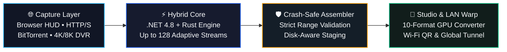

# ⚡ Nyxor Download Manager

### Multi-Threaded Rust Download Engine, BitTorrent Client, Media Studio & LAN Warp for Windows

[[https://img.shields.io/badge/Release-v2.1.5.0-2563EB?style=for-the-badge&logo=github&logoColor=white]](https://github.com/UacoderSYS/Nyxor-Download-Manager/releases)
[[https://img.shields.io/badge/Platform-Windows%2010%20%7C%2011%20(x64]-121212?style=for-the-badge&logo=windows&logoColor=white)](https://nyxorlabs.com)
[[https://img.shields.io/badge/Core-.NET%204.8%20%2B%20Rust-E65100?style=for-the-badge&logo=rust&logoColor=white]](https://nyxorlabs.com)
[[https://img.shields.io/badge/Themes-Light%20%26%20Dark%20GDI%2B-1E1E1E?style=for-the-badge]](https://nyxorlabs.com)
[[https://img.shields.io/badge/VirusTotal-Verified%20Clean-10B981?style=for-the-badge&logo=virustotal&logoColor=white]](https://www.virustotal.com/gui/file/001ba4a6e06aa480da08d355a0941df972285fcd2257b3a60bec2ee59316df98?nocache=1)

[Overview](#-overview) • [Architecture](#-architecture) • [Why Nyxor?](#-why-nyxor) • [Features](#-key-features) • [Screenshots](#-screenshots) • [Browser Extension](#-browser-integration) • [Quick Start](#-quick-start--verification) • [Support](#-community--support)

---

## 📌 Overview

**Nyxor Download Manager (NDM)** is a native 64-bit Windows desktop suite built for fast file transfers, torrenting, media capture, format conversion, and instant local file sharing — all inside one lightweight application.

Instead of relying on a single browser connection or juggling separate tools for torrents, video downloads, and media conversion, Nyxor pairs a **.NET Framework 4.8** double-buffered GDI+ interface with a native **Rust core library (`nyxor_core.dll`)** to handle multi-segmented HTTP/HTTPS transfers (up to 128 streams), P2P BitTorrent swarms, adaptive 4K/8K media streams, and direct LAN/QR device sharing.

---

## 🏗️ Architecture

---

## 📊 Why Nyxor?

| Capability | Nyxor Download Manager | Conventional Accelerators | Standard Web Browsers |
| :--- | :---: | :---: | :---: |
| **Max Concurrent Streams** | **Up to 128 (Adaptive Scaling)** | 8 – 32 Streams | 1 Stream |
| **Resume & Assembly Safety** | **Strict Range Checks + Crash-Safe Staging** | ⚠️ Basic Resume | ❌ Limited |
| **BitTorrent & Magnet Client** | **Built-in (File Tree + Sequential Play)** | ❌ Not Supported | ❌ Not Supported |
| **4K/8K Media & Live DVR** | **Built-in (Multi-Audio + Ad-Skip DVR)** | ⚠️ Limited / Breaks on DASH | ❌ Not Supported |
| **Media Studio Converter** | **Built-in (10 Formats + GPU + EBU R128)** | ❌ Not Supported | ❌ Not Supported |
| **LAN / Phone File Sharing** | **Built-in Nyxor LAN Warp (QR + Tunnel)** | ❌ Not Supported | ❌ Not Supported |
| **Interface & Themes** | **Dual Theme (Light & Dark GDI+) • 7 Languages** | Legacy Win32 UI | Standard Tab UI |
| **Privacy Model** | **100% Local Processing (`127.0.0.1`)** | Varies | Cloud-Synced |

---

## ⚡ Key Features

### 🚀 Adaptive Multi-Segment Engine & Crash-Safe Assembly
- **Up to 128 Parallel Streams:** Splits large downloads dynamically across concurrent connections and scales workers up based on real measured throughput, avoiding unnecessary server throttling.
- **Live Work Stealing (EndGame):** Automatically slices remaining byte ranges from slow or stalled connections and hands them to faster idle workers.
- **Strict Resume Integrity:** Validates byte ranges, `Content-Length`, and premature stream closures so dropped connections near the end of a file never shrink expected sizes or mark incomplete files as finished.
- **Disk-Aware Crash-Safe Merging:** Verifies chunk presence, ordering, and exact sizes before assembly. When free disk space allows, original chunks remain intact until the final file is flushed and verified; on tight drives, it automatically switches to zero-extra-space rolling assembly.
- **Reliable Session Persistence:** Saves active, paused, and empty download states cleanly across restarts and unexpected shutdowns.

### 🧲 Built-in BitTorrent & Magnet Engine
- **Direct `.torrent` & `magnet:` Support:** Open torrent files or magnet links directly in Nyxor with a pre-download file tree to pick specific files and set per-file priorities.
- **Sequential Streaming & Piece Verification:** Stream video files while downloading, verify pieces with SHA-1/v2 checks, and optionally stop seeding automatically at 100%.
- **Live Swarm & Tracker Inspector:** View connected peers, seed counts, tracker status, custom tracker injection, and IP ban controls in real time.

### 📡 Nyxor LAN Warp — Local & Cross-Network File Sharing
- **Instant Wi-Fi & QR Transfer:** Share completed downloads directly to your phone, tablet, or nearby PC over local Wi-Fi using a scannable QR code and PIN — with no cloud upload limits.
- **One-Click Global Tunnel:** Share across different networks when devices are not on the same Wi-Fi, with automatic link readiness checks and clean background process shutdown on app exit.

### 🎥 4K/8K Media Grabber, Multi-Language Audio & Live DVR
- **Universal Media Capture:** Extracts video, audio, and playlists up to **4K / 8K 60fps** from YouTube, Facebook (Reels/VOD), X/Twitter, TikTok, Instagram, Reddit, and Twitch.
- **Multi-Language Audio & Fast DASH:** Choose between original and dubbed audio tracks (including Arabic and international tracks), backed by 4–6 parallel DASH audio lanes with automatic byte rollback if a segment drops.
- **Live Stream DVR:** Records **HLS (`.m3u8`)**, **DASH (`.mpd`)**, and **FLV** live broadcasts in real time with automatic ad-pod filtering and stop timers.
- **Auto-Healing Links:** Detects expired stream tokens mid-transfer and refreshes them automatically without restarting from zero.

### 🎛️ Nyxor Media Studio & Site Grabber
- **10-Format GPU Converter:** Convert media across **MP4 (H.264), MKV, WebM (VP9), MOV, AVI, GIF, MP3, M4A, WAV, and FLAC** with hardware acceleration (NVENC / QSV / AMF).
- **Audio Mastering & Lossless Tools:** FastStart MP4 remuxing, EBU R128 loudness normalization, MP3 cover-art tagging, and precision video trimming.
- **Deep Site Grabber:** Scans web pages (including relative asset links via the native Rust scanner) into an interactive tree of videos, images, documents, and archives for batch queuing.

### 🎨 Dual Theme Engine (Light & Dark) & 7 Built-in Languages
- **Soft Alabaster Light & Fluent Dark:** Custom double-buffered GDI+ rendering with consistent contrast across the main window, Settings, Site Grabber, Media Grabber, dropdowns, scrollbars, and toast notifications.
- **7 Native Languages:** Full RTL and LTR interface support for **Arabic, English, Spanish, French, German, Portuguese, and Russian**.
- **Built-in Checksum Verifier & Proxy Diagnostics:** Verify **MD5, SHA-1, and SHA-256** hashes directly in-app, and configure **HTTP, HTTPS, SOCKS4, and SOCKS5** proxies with live latency testing.

---

## 📸 Screenshots

### 1. Main Workspace, Completion Center & Live Telemetry Inspector
*Double-buffered Fluent Dark workspace with automatic category routing, LAN Warp quick share, and live session telemetry.*

### 2. 8K/4K Media Grabber & Multi-Language Audio Selector
*Instant DASH stream parser supporting 8K AV1, 4K VP9, 2K, and 1080p60 with audio track selection.*

### 3. Multi-Segment Live Transfer Monitor
*Real-time socket inspection, adaptive bandwidth saturation, and per-connection segment progress.*

---

## 🧩 Browser Integration

Nyxor pairs with the official **Nyxor Browser Integration** extension (Manifest V3) for **Google Chrome** and **Microsoft Edge**:

- **Floating Media HUD:** Displays resolution badges (4K, 2K, FHD, HD, LIVE) directly over web videos with 1-click download, MP3 extraction, gallery image saving, and frame snapshots.
- **Inline Dismiss & Offline Awareness:** Hide the overlay per video when not needed, and see immediate visual status when Nyxor Desktop is closed.
- **Strict Local Privacy:** Communicates only with `127.0.0.1` on your machine — browsing history is never sent to external servers.

**Official Store Links:**
- [Google Chrome Web Store](https://chromewebstore.google.com/detail/nyxor-browser-integration/fmbpmhpahecfneoanghjcdnoiipgagon)
- [Microsoft Edge Add-ons](https://microsoftedge.microsoft.com/addons/detail/nyxor-browser-integration/dlnncpfaaejjbdgkfabhjjnnjhhboapp)

---

## 🚀 Quick Start & Verification

### System Requirements
- **OS:** Windows 10 / Windows 11 (64-bit)
- **Runtime:** .NET Framework 4.8 or newer
- **Storage:** SSD recommended for high-concurrency multi-segment assembly

### Download & Verify (`v2.1.5.0`)

| File | Platform | Size | SHA-256 Checksum |
| :--- | :--- | :--- | :--- |
| `NyxorDM.exe` | Windows 10 / 11 (x64) | 32 MB | `1c38e0078dc1faaf3d2a137804293c271a6f07cdd009a6af71cc0418c76ae65e` |

- **Download:** Grab `NyxorDM.exe` from **[GitHub Releases](https://github.com/UacoderSYS/Nyxor-Download-Manager/releases)** or **[nyxorlabs.com](https://nyxorlabs.com/#get-started)**.
- **Security Scan:** [Official VirusTotal Report](https://www.virustotal.com/gui/file/001ba4a6e06aa480da08d355a0941df972285fcd2257b3a60bec2ee59316df98?nocache=1)
- **Trial & Licensing:** Includes a full-featured **14-day free trial** (no credit card required), followed by a **$15 one-time lifetime license**.

### ⌨️ Keyboard Shortcuts

| Shortcut | Action |
| :--- | :--- |
| **Ctrl + N** | Add New Download URL |
| **Ctrl + B** | Batch Add Downloads |
| **Space** | Pause / Resume Selected Task |
| **Delete** | Open Smart Deletion Prompt |
| **Ctrl + A** | Select All Tasks |
| **Ctrl + ,** | Open Settings |

---

## 🔧 Optional Auxiliary Tools

Nyxor's core networking, multi-segment downloading, BitTorrent swarm engine, LAN Warp sharing, and file assembly run natively in **Nyxor (.NET + Rust)**. Two optional open-source utilities are used strictly for specialized media tasks:

- **[yt-dlp](https://github.com/yt-dlp/yt-dlp):** Optional manifest resolver used for restricted YouTube streams and dubbed multi-language track discovery. All actual high-speed segmented downloading and assembly remain handled by Nyxor's own engine.
- **[FFmpeg](https://ffmpeg.org/):** Used for lossless DASH audio/video muxing, Live DVR remuxing, and Media Studio format conversions.

---

## 💬 Community & Support

- 🌐 **Official Website:** [nyxorlabs.com](https://nyxorlabs.com) · [Changelog](https://nyxorlabs.com/changelog)
- 📢 **Telegram Community:** [@nyxorglobal](https://t.me/nyxorglobal)
- ▶️ **YouTube Channel:** [@nyxorlabs](https://www.youtube.com/@nyxorlabs)
- 📧 **Support & Inquiries:** `info@nyxorlabs.com` | `nyxorlabs@gmail.com`

---

*Developed by **Uacoder** • Copyright © 2026 **Nyxor Labs**. All rights reserved.*
